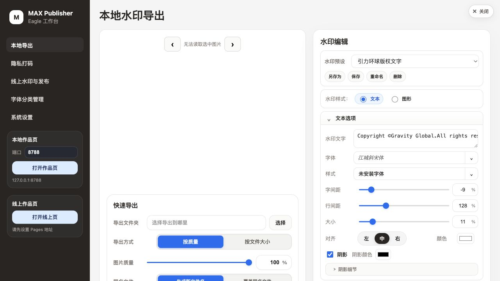
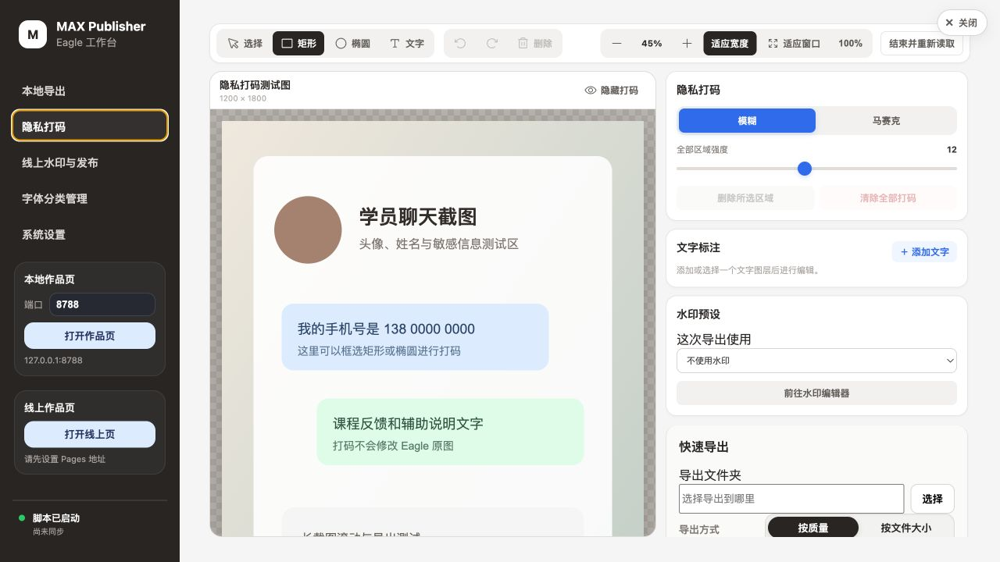
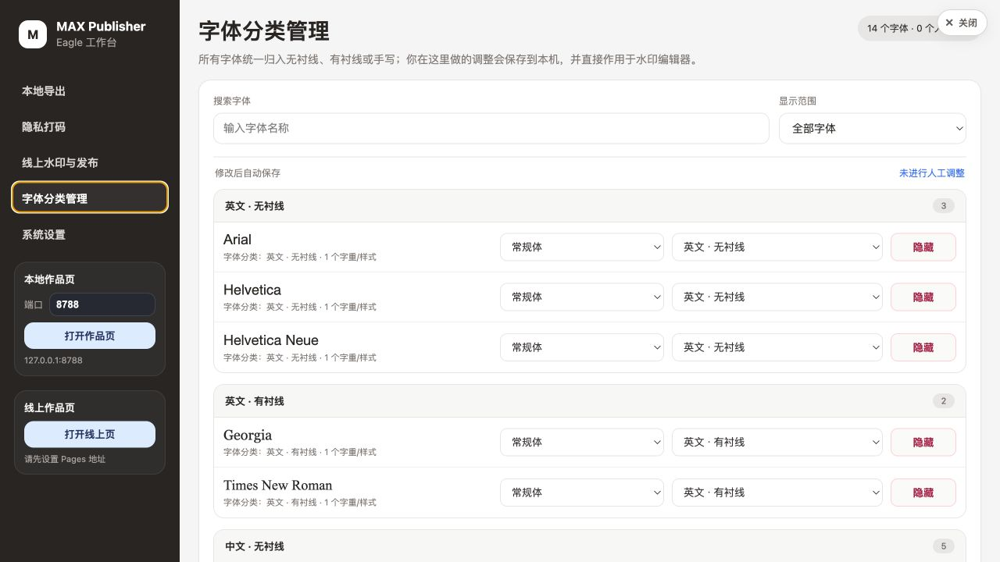

# Gravity Global Eagle Extension Suite

这是引力环球的 Eagle 扩展稳定发行仓库。当前发行只包含两套独立插件：

- **媒体智能整理** `2.5.22-qa.27`：普通文件夹与智能文件夹排序、手动相对顺序、排序锁定、安全编号/改名、拍摄时间、离线 GPS/元数据标签、团队排序状态同步。排序行为仍是 qa.26 冻结基线，qa.27 只增加首次标签安全。
- **MAX Publisher** `1.2.7`：水印编辑、隐私马赛克/模糊、文字标注、动态读取本机字体、本地导出，以及暂用的 Cloudflare Pages 发布流程；图片处理依赖已升级到无已知生产漏洞的 `sharp 0.35.3`。

## 重要结论

- GitHub 分发的是软件，不包含任何 Eagle `.library`、照片、视频、NAS 路径、个人配置、API Key 或团队排序状态。
- 同一团队打开同一 NAS Library 时，媒体智能整理会自动读取 Library 旁的
  `*.library.eagle-team-state.json`，恢复已保存的普通/智能文件夹规则和手动相对顺序；成员不需要重新排序。
- 自动标签完全离线，不需要地图 API、AI API 或 token。
- 水印、马赛克、字体和本地导出不需要 API Key。
- Cloudflare 线上发布是可选功能，凭据只通过本机 `wrangler login` 或环境变量提供，永远不提交到 GitHub。
- 对精确匹配的官方 Eagle 4.0.0 build 23，完整安装器会在本机生成排序通信桥、先保存原版回滚文件，再安装两个插件；仓库不包含 Eagle 完整二进制。

## 当前发行状态

| 功能 | 版本 | 自动门禁 | 真实 Eagle 状态 |
| --- | --- | --- | --- |
| 普通文件夹排序 | qa.26 冻结行为，随 2.5.22-qa.27 发行 | 通过 | 当前稳定基线 |
| 智能文件夹排序/手动顺序 | qa.26 冻结行为，随 2.5.22-qa.27 发行 | 通过 | 当前本机 qa.26 已验收；qa.27 未安装 |
| 团队排序状态 | schema v2 | 完整性、冲突、原子写入测试通过 | 当前正式 NAS sidecar 有效 |
| GPS/元数据标签 | 2.5.22-qa.27 | 通过 | 干净安装默认不扫描整库；首次开启只建基线 |
| 水印/马赛克/字体/导出 | 1.2.7 | 82/82 通过；生产审计 0 漏洞 | 发行候选；安装后需在真实 Eagle 做一次冒烟验收 |
| Cloudflare Pages 发布 | 1.2.7 | 构建通过 | 暂用功能，需用户自己的 Cloudflare 配置 |

自动测试通过不等于所有电脑和所有真实素材均无缺陷。真实 Eagle 界面是最终验收真源；任何现场差异都应按仓库中的回滚和问题模板处理。

## 功能界面

下列截图来自不含真实 Library、NAS 路径或业务素材的脱敏演示环境。

### 水印编辑器



### 隐私打码与马赛克



### 字体分类管理



## 给 Codex 的最短安装入口

把本仓库链接交给 Codex，并发送：

> 请严格阅读 `docs/INSTALL_WITH_CODEX.md`，先运行只读检查。只有 Eagle 4.0.0 和 app.asar 指纹精确匹配时才允许继续；批准后运行完整安装器，由它自动备份并在本机生成受控排序通信桥、安装两个插件。禁止绕过指纹，禁止编辑 `.library`，禁止扫描、改名或删除真实素材，禁止把任何 API Key 写入仓库或日志。

完整说明：

- [完整功能说明](docs/FEATURES.md)
- [Codex 安装指南](docs/INSTALL_WITH_CODEX.md)
- [GitHub 团队访问](docs/GITHUB_TEAM_ACCESS.md)
- [团队排序同步](docs/TEAM_SORT_SYNC.md)
- [配置与 API](docs/CONFIGURATION.md)
- [验证、升级与回滚](docs/VERIFICATION.md)
- [发行范围与已知限制](docs/RELEASE_SCOPE.md)
- [2026.08.01 发行说明](docs/RELEASE_NOTES_2026.08.01.md)

## 仓库结构

```text
plugins/
  media-organizer/       媒体智能整理源码
  max-publisher/         MAX Publisher 源码
releases/                已校验的 Eagle 安装包
scripts/                 只读检查、安装与回滚脚本
docs/                    安装、配置、团队同步和验收说明
assets/screenshots/      不含真实 Library/业务素材的演示截图
release-manifest.json    版本、插件 ID 和 SHA-256 真源
```
