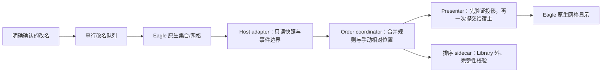

# Eagle Extension Suite 功能与实现架构

本页说明“功能由哪里实现、配置存在哪里、哪些东西绝不能混在一起”。它是给团队维护者和后续 Codex 的地图，不替代用户使用指南。

## 三条主业务线

| 业务线 | 用户看到的功能 | 主要实现 | 配置/状态边界 |
| --- | --- | --- | --- |
| 排序与安全改名 | 普通/智能文件夹、多级排序、拍摄时间、手动拖动、锁定、自动编号 | `extensions/media-organizer/lib/{sorting-system-core,order-coordinator-core,manual-*-core,rename-*-core}.js` | `eagle.sorting.*`；团队状态只在 `.library` 外 sidecar |
| 媒体处理与线上发布 | 水印、字体、隐私模糊/马赛克、快速导出、线上展示 | `extensions/online-publisher/eagle-plugin/modules/`、`lib/publisher.js`、`adapters/eagle/` | `eagle.mediaPublishing.*`；发布凭证只在操作者本机 |
| GPS/元数据标签 | EXIF/视频位置读取、地点解析、审核、人工纠错、文件夹标签 | `extensions/media-organizer/lib/{geo-tag-service,media-location}.js` | `eagle.metadataTags.*`；本机处理缓存不入 Git、不进团队排序 sidecar |

三条业务线只可通过宿主 adapter、日志、存储、队列与错误模型等基础设施协作，不能 import 对方的业务实现、共享可变状态、配置键或全局事件。完整约束见 [模块边界](EAGLE-EXTENSION-MODULE-BOUNDARIES.md)。

## 排序与改名：数据从哪里来、怎样生效

- `sort-core.js` 和 `sorting-system-core.js` 负责确定性比较器、多级规则和字段解释。
- `order-coordinator-core.js` 只负责把“当前规则 + 已保存的手动相对位置 + 锁定状态”合成为最终顺序。
- `manual-drop-transaction-core.js`、`manual-move-application-core.js` 只在明确拖放成功时记录手动顺序；不能从刷新或渲染顺序反推用户意图。
- `smart-collection-*.js` 是智能文件夹专用投影链。智能文件夹是虚拟集合，不能沿用普通文件夹的同步 DOM/数组假设；提交前必须同时证明数据投影与可见卡片一致，否则 fail-open，让 Eagle 原生继续工作。
- `rename-command-queue.js`、`rename-lifecycle-core.js` 只在普通文件夹、用户明确确认、最终排序已经确认后执行安全改名。锁定时必定拒绝写入。

### 排序优先级（对用户可见的语义）

1. Eagle 原生能力永远优先：选择、预览、右键、导入导出、拖到 Finder/聊天框/上传框及集合语义不得被插件截断。
2. 排序锁定是插件内部最高保护状态；锁定后不能改变顺序、手动位置或文件名。
3. 未锁定时，当前排序规则先形成“规则顺序”；明确手动拖动只对规则顺序做相对位置调整。
4. 自动编号最后消费已确认的最终顺序，且只在普通文件夹中执行。

这不是“插件无条件覆盖 Eagle”：插件无法确认事件或投影所有权时必须放行 Eagle 原生行为。排序的全部历史故障都以 R-ID 固化在 [永久回归契约](../extensions/media-organizer/docs/PERMANENT-REGRESSION-CONTRACT.md)。

## GPS/元数据标签

GPS 模块独立读取图片 EXIF 和视频位置字段，在离线数据集中解析地点。写标签之前先生成可审核的计划；确认后才调用 Eagle 标签能力。处理记录以资源库为边界，避免反复扫描；人工纠错优先于后续自动结果。它不会调用在线地图 API、不会上传坐标，也不能触碰排序或改名状态。

## MAX Publisher

| 模块 | 实现位置 | 作用 |
| --- | --- | --- |
| 水印编辑器 | `eagle-plugin/modules/watermark-editor/` | 预设、实时预览、样式与导出参数 |
| 字体目录 | `eagle-plugin/modules/font-manager/` | 本机字体发现、分类与元数据；不分发字体文件 |
| 隐私编辑器 | `eagle-plugin/modules/vendor/gravity-privacy-editor/` | 矩形/椭圆模糊、马赛克、文字标注 |
| 快速导出 | `eagle-plugin/modules/quick-export/` | 水印与隐私页共享的导出入口 |
| Eagle/发布适配 | `eagle-plugin/adapters/eagle/`、`lib/publisher.js` | Eagle 选中项、窗口/通知、本地导出和 Cloudflare Pages 发布 |

水印和隐私操作只生成导出副本，不能覆盖 Eagle 原图。线上发布使用操作者自己的 Cloudflare 登录态或环境凭证；仓库中不保存任何 token。

## 其余独立能力

- `extensions/live-photo-manager/`：Live Photo 的配对、冲突识别、预览队列与恢复锚点。当前不封装 `.livp`、不写 Eagle Library、不直接导入正式 NAS。
- `extensions/avatar-source-publisher/`：指定 Eagle 头像文件夹是唯一人工维护入口；它导出不含绝对路径的版本化 manifest 和内容寻址 assets。MORROW 只能通过其自己的 adapter 消费该契约，不能调用 Eagle API 或读取 `.library` 内部。
- `tools/icloud-intake-workbench/`：本地、可恢复的搬运台账。当前仅用于计划和核对，绝不静默下载、删除、移动或导入素材。

## 发布与验收门禁

1. 先跑源码契约和自动测试；失败先写回归测试再修最小所有权模块。
2. 构建只包含运行时文件的干净插件包；包内禁止状态、备份、Library 路径、测试资料和宿主桥接载荷。
3. 安装前确认 Eagle 已退出、插件 ID 唯一、宿主指纹符合审计基线。安装器不得修改 `app.asar`。
4. 自动测试通过只代表可以进入现场；真实 Eagle 验收才是最终结果。测试或检查不得改动用户的排序、文件名、NAS 素材或 `.library`。
5. 出现异常时先停用插件验证 L0 原生能力，再通过本机插件回滚点恢复；禁止手改 `.library`。
