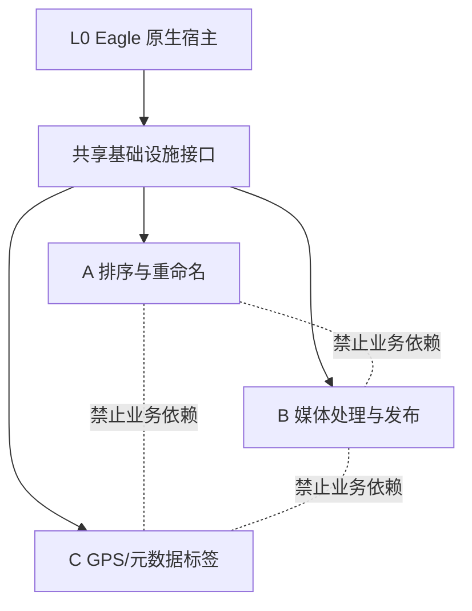

# Eagle 扩展模块边界与宿主主权契约

状态：强制约束。本文约束所有 Eagle 扩展，不因插件名称、版本号或目录变化失效。

## L0：Eagle 原生主权

Eagle 原生能力永远高于扩展能力。扩展只能附加功能，不能改变下列原生语义：

- 浏览、选择、预览、右键菜单和快捷键；
- 照片拖到 Finder、桌面、聊天框、上传框或其它应用；
- 原生导入、导出、普通文件夹、智能文件夹和全部视图；
- 原生文件引用、缩略图、右侧预览和 Library 生命周期。

任何扩展关闭、卸载、崩溃或初始化失败后，上述能力必须保持完整。业务插件运行时不得
修改 `app.asar`；唯一例外是发行安装器对清单精确支持的官方宿主，在 Eagle 完全退出、
原版已完成指纹校验并创建回滚文件后，本机生成并原子安装已审计通信桥。未知指纹必须
拒绝且不能绕过。任何模块均不得直接改写 `.library` 内部结构，也不得通过全局事件监听器
提前取消 Eagle 原生事件。

## 三个产品模块

| 模块 | 业务所有权 | 禁止包含 |
| --- | --- | --- |
| A：排序与重命名 | 集合识别、父/叶层对象、自动排序、手动顺序、保护 guard、编号预览、安全改名 | GPS、标签、水印、发布、视频处理 |
| B：媒体处理与线上发布 | 水印、打码、视频处理、线上展示与发布 | 排序规则、手动顺序、编号状态、GPS 标签 |
| C：GPS/元数据标签 | GPS/元数据读取、地点解析、标签计划和标签写入 | 排序规则、手动顺序、编号任务、媒体发布 |

三个模块不得互相 import 业务实现，不得共享可变业务状态，不得复用配置键，不得
注册同名全局事件，也不得共同修改同一个宿主 UI 节点。任一模块关闭、报错或升级，
不得改变另外两个模块的运行结果。

## 允许共享的基础设施

共享层只能提供不含业务规则的接口：

- `EagleHostAdapter`：只读集合快照、原生事件边界、原生改名提交与结果确认；
- `Lifecycle`：启动、停止、Library 切换和模块健康状态；
- `KeyValueStore`：命名空间隔离、schema 版本、迁移事务；
- `TaskQueue`：按模块和 collection ID 隔离的串行任务；
- `Logger`、`Clock`、`ErrorModel` 和诊断事件。

共享层不得知道“人物组”“拍摄时间排序”“地点标签”“水印”等业务概念。业务模块
只能依赖接口，不能直接依赖另一个模块的文件或全局对象。

## 依赖方向

## 生命周期与事件所有权

1. 每个模块必须有独立 `start/stop/status`，重复启动保持幂等。
2. 模块停止时必须移除自己的监听器、计时器、观察器和队列，不得留下全局副作用。
3. 只有明确拥有当前事件和当前落点的模块才能调用 `preventDefault` 或
   `stopPropagation`；不能确定所有权时必须让 Eagle 原生继续处理。
4. A 模块只可在有效网格内部排序落点接管 `dragover/drop`。`dragstart`、
   `dataTransfer` 和网格外拖放归 Eagle。
5. C 模块只能在用户主动打开或明确启用标签功能后初始化，不得由排序启动触发。
6. B 模块不得注册或修改排序网格的拖动语义。

## 配置与运行数据

目标命名空间必须拆分：

- A：`eagle.sorting.*`
- B：`eagle.mediaPublishing.*`
- C：`eagle.metadataTags.*`
- 共享基础设施：`eagle.extensionInfra.*`

迁移旧键时只能复制到所属模块，必须保留原键用于回滚，不能把排序、保护、手动顺序、
编号和标签状态放进同一个可变对象。sidecar 必须位于 `.library` 外，并记录 schema、
模块、Library ID、完整性哈希和迁移来源。

## 当前事实与违规点

截至 2026-07-23，`extensions/media-organizer/plugin.js` 同时加载 A 和 C 的业务实现，
共享一个生命周期、一个宿主注入字符串、一个监控循环和一个插件窗口；
`team-sort-state-core.js` 也同时携带排序键与简介/元数据键。这是待迁移的现状，
不是允许继续扩展的架构。

B 已位于 `extensions/online-publisher`，但仍需通过契约测试确认它不触碰 A/C 的事件、
配置和 UI。迁移不得直接删除现有实现或用户状态；先建立兼容 adapter 和影子读模型，
再逐项切换所有权。

## 强制门禁

- 修复前先查历史 bug 台账和受影响规则。
- 先写失败测试，再改最小模块。
- 自动测试只能决定是否允许进入现场，不能宣布真实可用。
- 真实 Eagle 测试必须经用户再次批准，并使用明确测试目录和恢复点。
- 未经批准不得安装、重启、操作真实 Library 或 NAS 素材。
- 任一 L0 原生能力受损，三个模块全部判定不可发布。
