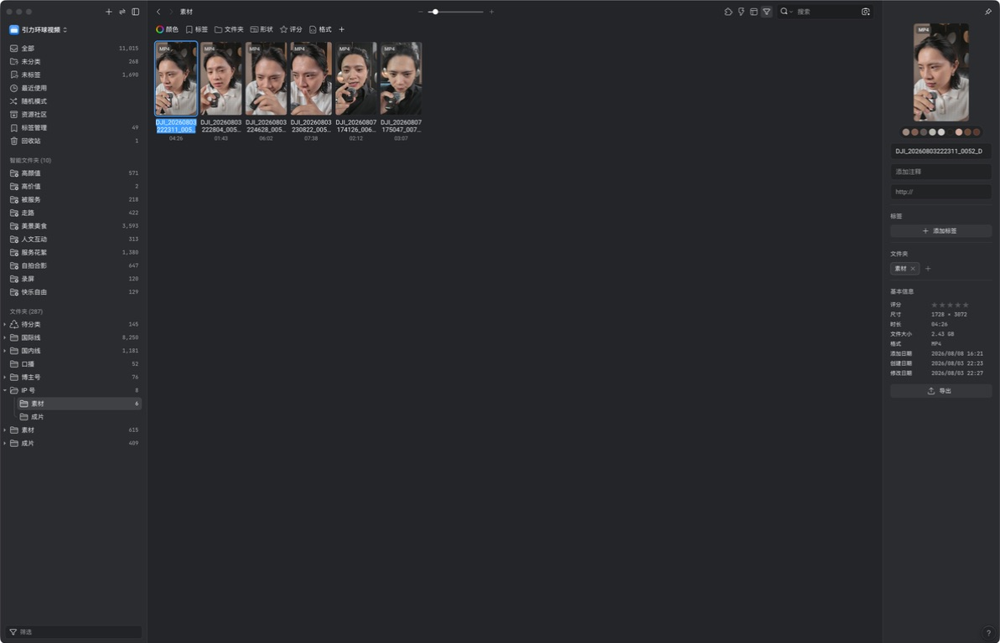

# Eagle Extension Suite 团队安装、配置与使用指南

更新时间：2026-10-29。面向从 GitHub 获取本仓库、希望在自己的 Mac 上使用 Eagle 扩展的团队成员。

## 你将获得什么

| 功能 | 给谁用 | 是否需要密钥 |
| --- | --- | --- |
| 媒体智能整理 | 需要统一排序、手动微调、编号或地点标签的成员 | 否 |
| MAX Publisher | 需要水印、隐私打码、导出或线上作品页的成员 | 仅线上发布需要本人 Cloudflare 凭证 |
| Live Photo 管家 | 需要安全检查 JPG/HEIC + MOV 配对的成员 | 否 |
| 头像共享源 | 维护指定 Eagle 头像文件夹的管理员 | 否；消费者只读取共享源 |
| Instagram / 小红书导入器 | 需要将单条公开帖子整理为 Eagle 导入计划的成员 | 否 |
| Eagle 工作台 | 需要查看每个扩展的产品版本、基本功能和版本修复记录的成员 | 否 |
| iCloud 搬运台账 | 管理 iCloud 素材批次的成员 | 否；当前不执行下载 |

## 开始前的三件事

1. 使用 macOS 和 Eagle `4.0.0`；先完全退出 Eagle。
2. 团队成员可读写同一 NAS Library 时，各自用自己的挂载路径打开它。不要把某台电脑的 `/Volumes/...` 路径写进配置。
3. 本仓库没有、也不应有任何人的 API Key、Cloudflare 登录态、Eagle Library、素材、缓存或备份。线上发布由每个操作者在自己电脑上授权。

## 给 Codex 的安装指令

在 Codex 新建任务后，把下面这一段和本 GitHub 仓库链接一起发送即可：

```text
请按 Eagle Extension Suite 的 docs/GITHUB-SETUP-AND-USER-GUIDE.md 安装。
先只读执行预检：确认 Eagle 已退出、版本为 4.0.0、同 ID 插件来源只有一个、
没有修改 app.asar/.library/NAS 素材的动作。通过后先运行各扩展测试，
再构建干净发布包。只有预检、测试和包校验全部通过，才安装插件。
若宿主版本或原始 `app.asar` 指纹不匹配，立即停止并报告；只有通过仓库桥接脚本的精确
版本/指纹检查，才允许在 Eagle 完全退出后重建桥接，不得绕过检查硬覆盖。
安装后只读打开目标 Library 做冒烟检查；不拖动、不改名、不导入、不删除。
```

这段指令的目的，是让每台电脑都先确认宿主兼容性和唯一插件来源，而不是“能装就装”。

## 安装媒体智能整理

该插件当前源码版本为 `2.5.22-qa.94`，用户界面产品版本为 `2.5`。排序主网格接入依赖经过审计的 Eagle 4.0.0 宿主通信桥。仓库不上传 Eagle 主程序二进制；目标电脑使用 `bridge/rebuild-compatible-bridge.js` 从本机原始 `app.asar` 重建两个固定桥接入口，脚本会先备份并验证原始文件。

```bash
git clone https://github.com/maxmaximage-hash/eagle-extension-suite.git
cd eagle-extension-suite/extensions/media-organizer
npm ci
npm test
zsh scripts/build-github-release.sh
cd bridge
npm ci
node rebuild-compatible-bridge.js --check
cd ..
zsh releases/install-媒体智能整理-v2.5.22-qa.94.sh --check
```

桥接检查通过后，完全退出 Eagle，再运行：

```bash
cd bridge
node rebuild-compatible-bridge.js --install
cd ..
```

随后确认插件预检通过，再安装插件：

```bash
zsh releases/install-媒体智能整理-v2.5.22-qa.94.sh --install-plugin
```

安装器会拒绝以下情况：宿主版本/审计指纹不匹配、发行包哈希不匹配、Eagle 正在运行、或发现同一插件 ID 的第二份来源。它会为被替换的旧插件创建本机回滚点，但不会读取或修改当前 Library。

### 安装 Eagle 工作台

工作台是只读汇总面板，不接管排序、改名、标签、导入或发布。源码目录运行
`npm test && npm run package` 后，将生成的 `eagle-workbench-1.1.eagleplugin` 拖入 Eagle
安装。打开后每张卡片先显示基本功能，再显示当前版本日志；它不显示无效的入口按钮或
“已安装登记”标签。

### 排序怎样同步给团队

排序规则、锁定状态、手动视图和显示设置会作为经过完整性校验的团队 sidecar 放在目标 `.library` **旁边**，不是 `.library` 内部。成员安装相同版本的插件并打开同一个 NAS Library 后会自动读取，不需要“发布团队状态”按钮。

- 普通文件夹与智能文件夹的状态独立保存。
- 自动编号状态会同步，但接收电脑不会自动启动改名；改名必须由操作者再次确认。
- NAS 不可访问、校验失败或发现其他电脑写入冲突时，插件保留上一次有效状态，不会把“读不到”当作“已删除”。

## 安装 MAX Publisher

```bash
cd eagle-extension-suite/extensions/online-publisher
npm ci
npm test
npm run build:privacy
npm run package:plugin
```

然后在 Eagle 的插件安装入口选择生成的 `max-eagle-publisher-1.2.7.eagleplugin`。水印、马赛克、模糊、文字标注、系统字体发现与本地导出均不需要 API Key。

线上发布使用 Cloudflare Pages：只在需要发布的成员电脑上执行 `wrangler login` 或按团队安全流程配置该成员自己的环境凭证。不要把 token 写入仓库、插件配置、截图或聊天记录。

## 功能怎么用

### 1. 排序与安全改名

打开 Eagle 右上角布局/排序面板：

1. 选“拍摄时间排序”只按拍摄时间；选“多级排序”可组合最多 8 个字段（文件名、拍摄时间、类型、扩展名、添加/修改/创建日期、大小、分辨率、星级、时长）。每级有独立升降序，第一条规则优先级最高。
2. 手动拖动默认开启。它只记录你明确拖过的相对位置；规则切换时，手动项保持相对位置，不会把整个文件夹固化成旧画面。
3. “排序锁定”是最高保护层：锁定后不允许新的排序、手动拖动或真实改名；解除锁定不会清除已保存的顺序。
4. “恢复规则顺序”才会清除该集合的手动视图并重新应用当前规则。
5. 自动编号只适用于普通文件夹。它消费当前已确认的最终顺序后再改名；智能文件夹不提供自动编号，避免把跨来源的虚拟结果写回原文件。


### 2. GPS/元数据标签

从 Eagle 插件菜单打开“媒体智能整理”，即可扫描当前文件夹或启用对新导入媒体的增量处理。图片读取 EXIF GPS，视频读取 QuickTime/ffprobe 的位置字段；地点解析离线完成，不上传照片或坐标。先审核结果，再确认写入 Eagle 标签；人工纠正会优先于之后的自动识别。

### 3. 水印、隐私打码与字体

在 MAX Publisher 中选择 Eagle 项目后：

1. 用水印编辑器创建文字或图形水印并保存预设。
2. 在“隐私打码”页面用矩形/椭圆模糊、马赛克或文字标注遮盖敏感信息。
3. 从字体目录选择本机字体；字体元数据不携带字体文件，团队成员需要在自己电脑上拥有对应字体。
4. 使用统一的快速导出流程生成副本。原始 Eagle 素材不被改写。

### 4. 线上展示

给需要上线的素材添加 `线上展示` 标签，在 MAX Publisher 的“线上发布”页进行同步。发布前核对公开内容、作品页地址与 Cloudflare 登录身份；发布密钥和页面运行状态始终留在本机。

### 5. Live Photo 管家和 iCloud 搬运台账

Live Photo 管家会识别同名 JPG/JPEG/HEIC 与 MOV 的安全配对，缺件或重复时进入冲突队列，绝不猜测配对。iCloud 搬运台账只记录批次、冲突和“继续上次”的选择锚点；它目前不登录 iCloud、不下载、不创建 NAS 目录。

### 6. Instagram / 小红书单帖导入

两个导入器均是独立的浏览器扩展源码：只把当前公开帖子的图片、视频和必要来源信息组织成导入计划。安装前分别进入对应目录运行 `npm test` 与 `npm run check`，再按各自 README 的浏览器开发者模式流程加载。它们不覆盖 Eagle 现有素材，也不能用于批量抓取或绕过站点权限。

## 界面示例



截图仅用于说明界面；不代表团队成员的真实素材、排序数据或线上发布内容会被上传到 GitHub。

## 更新、回滚与问题处理

- 更新前先退出 Eagle，运行测试和 `--check`；不要把新包覆盖到第二个同 ID 插件目录。
- 插件替换后，安装器会在本机 Eagle 备份目录留下旧插件回滚点。回滚只恢复插件，不涉及 `.library` 和 NAS 素材。
- 预检因“宿主通信能力不受支持”而停止，是安全保护：不要强行安装，也不要让 Codex 改 `app.asar`。请回到团队的已审计宿主基线。
- 看到 NAS 首次打开较慢、缩略图渐进显示时，先让 Eagle 完成本身的资源库枚举。插件不得扫描 `.library` 内部或用轮询替代原生加载。
- 发现排序、拖动、预览、右键、导入导出或拖出异常时，立即停用/卸载插件验证 Eagle 原生行为，并在 issue 中提供复现步骤、插件版本、Eagle 版本和截图；不要手改 `.library`。

更完整的实现边界与代码定位见 [功能与实现架构](ARCHITECTURE-AND-FEATURE-MAP.md)。
