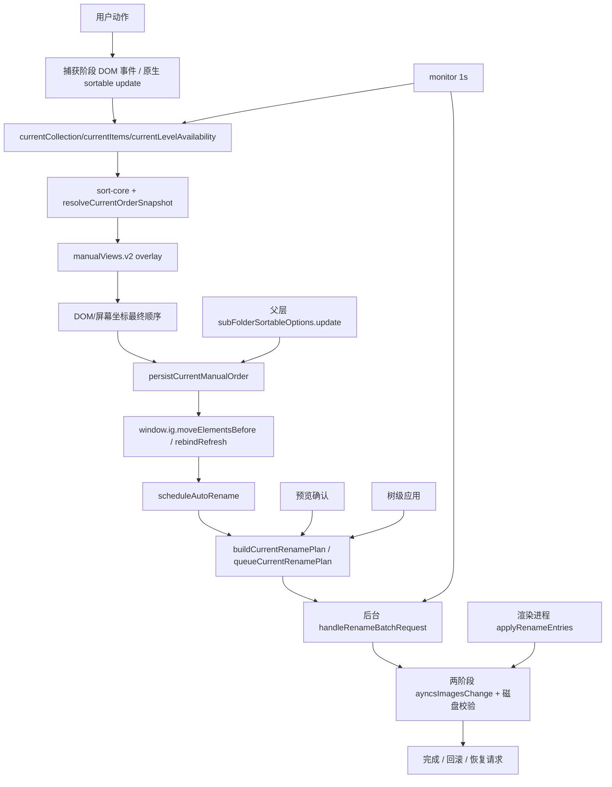

# 排序与重命名结构化审计：2026-07-23

## 结论先行

现有实现不是一条可证明唯一的排序链。`plugin.js` 共 7,846 行，同时承担宿主桥接、
排序 UI、集合识别、手动拖动、保护、编号、改名事务、团队状态、拍摄时间、GPS 和
标签。排序内部至少有两条拖动入口、两条改名执行入口和多个隐式刷新/轮询入口。
继续在该文件现场补丁会重复制造互相覆盖的行为。

本审计不决定立即重写或删除。目标是冻结事实，先建立边界和门禁，再用小批次迁移。

## 版本、发布包与运行状态

| 类别 | 事实 |
| --- | --- |
| 正式源码 | `extensions/media-organizer`，manifest/package 均为 2.5.21 |
| 已安装版 | `com.max.eagle-photo-taken-sort`，2.5.21 / API 77 |
| 当前哈希 | 源码与安装版 `plugin.js` 均为 `8e07dc...8d76` |
| 回滚点 | `media-organizer-before-api77-native-drag-20260723-175140`，API 75，`97e58d...ea7` |
| Eagle | 4.0.0 build 23，当前仍运行，本阶段不再操作 |
| 发布包 | 2.4.2-2.4.8、2.5.0-2.5.21 共 29 个包，另有一个 2.4.8 布局前备份包 |
| Git 历史 | 仓库仅有 2026-07-18 两个迁移/交接提交；7 月 19-23 的修复主要存在于未提交工作区、TASKS/DECISIONS、发布包和安装备份 |
| 3.0 原型 | 已停止，不是当前运行实现；对应安装测试目录已有禁用备份 |

发布包的主窗口 API 演进：2.4.2=34、2.4.3=35、2.4.4=38、2.4.5=39、
2.4.6-2.4.7=40、2.4.8=41、2.5.0-2.5.7=50、2.5.8=51、2.5.9-2.5.12=52、
2.5.13=53、2.5.14=54、2.5.15=55、2.5.16=56、2.5.17=57、2.5.18=58、
2.5.19=59、2.5.20=60、2.5.21 发布包=68。安装版继续在同一 2.5.21 manifest 下
演进到 API 77，说明“manifest 版本”已不能唯一标识现场行为。

## 现有源码盘点

### A：排序与重命名相关

| 文件 | 行数 | 当前责任 | 目标处理 |
| --- | ---: | --- | --- |
| `plugin.js` | 7,846 | 全部宿主注入、UI、拖动、监控、改名及 C 模块 | 只保留薄启动器；逐步提取 |
| `lib/sort-core.js` | 376 | 比较器、规则、手动覆盖 | 保留并收紧纯函数契约 |
| `lib/collection-core.js` | 278 | 普通/智能集合和状态 profile | 提取为 L2/L8 边界 |
| `lib/sorting-system-core.js` | 240 | guard、顺序快照、改名请求 | 拆成 command pipeline |
| `lib/folder-level-core.js` | 133 | 父/叶层目标和文件夹编号计划 | 保留，移除宿主假设 |
| `lib/folder-tree-batch-core.js` | 184 | 后代遍历、批处理、回滚 | 保留为 scope 纯核心 |
| `lib/rename-core.js` | 104 | 编号计划与两阶段名称 | 保留为纯计划 |
| `lib/rename-batch-core.js` | 121 | 多文件夹计划和冲突 | 保留，禁止直接执行 |
| `lib/monitor-core.js` | 20 | 扫描上下文键 | 迁入 adapter 诊断，不得触发改名 |
| `lib/team-sort-state-core.js` | 413 | 排序、保护、手动、编号和 meta 键接力 | 按模块拆分；旧键只读迁移 |

### C：当前错误耦合在同一插件中的能力

`geo-resolver.js`、`geo-tag-service.js`、`media-location.js`、`folder-tag-core.js`、
`index.html` 的标签/GPS 页面和 `plugin.js` 约 6,600 行后的标签逻辑属于 C。它们与
A 共用 `onPluginRun`、监控状态、窗口和错误通道，必须隔离，但本阶段不修改其功能。

B 位于 `extensions/online-publisher`，当前不在本轮代码范围。

## 配置键和运行文件

### Local Storage

| 所属 | 键 | 现状 |
| --- | --- | --- |
| A 规则 | `eagle.photoTakenSort.rules.v2` | 当前规则库 |
| A 规则兼容 | `rules.v1`、`fallbackOrder` | 旧键，只应读迁移 |
| A 手动输入 | `manualMode.v1`、旧 `manualEnabled` | 是否允许新拖动 |
| A 手动顺序 | `manualViews.v2` | Library + collection 隔离 |
| A 保护 | `sortingLocks.v3` | 当前硬锁 |
| A 保护兼容 | `folderLocks.v1`、`protection.v2` | 旧保护与旧快照来源 |
| A 编号 | `autoRename.v1` | 编号开关与 collection profile |
| A/C 混合 | `metaProfiles.v1` | 当前放在团队排序状态中，目标归 C/显示 adapter |
| 接力基础设施 | `teamImport.v1`、`teamImportBackup.v1` | 当前同时处理 A/C 键 |
| Eagle 原生 | `eagle.list.orderBy`、`eagle.list.sortIncrease`、`eagle.list.meta.type` | 只能由 adapter 访问 |

### sidecar、缓存和恢复文件

- Library 同级：`<library>.eagle-team-state.json`，不在 `.library` 内。
- 插件目录：`photo-taken-cache.json`、`diagnostic.log`、`rename-batch-backup.json`、
  `rename-batch-cancel.json`、`rename-recovery-request.json`、`window-state.json`。
- C 模块运行状态：`geo-tag-state.json`。
- 内置交接源：`defaults/sort-state/team.eagle-sort-state.json`。
- 历史恢复请求：`recovery/*.json`。它们不是新版本默认执行许可。

这些文件必须分别声明 owner、schema、Library ID 和生命周期。当前插件目录同时保存
A/C 状态，是模块隔离风险。

## 宿主桥接、事件、计时器和队列

### 宿主桥接

- 后台通过 `eagle.photoTakenSort.execute()` 注入主窗口字符串。
- 注入代码直接读取 Angular `bodyScope`、`allData`、`filtereds`、`raw`、DOM 卡片、
  `window.ig`、`rebindRefresh`、`sortRawData` 和 `ayncsImagesChange`。
- `window.__eaglePhotoTakenSort` 既是 UI API、状态容器、测试入口，也是批任务通道。
- 该边界没有独立 adapter，因此 L2/L7/L8 规则散落在同一注入函数中。

### 全局事件

- 文档捕获阶段：`dragstart`、`dragover`、`drop`、`dragend`、`keydown`、
  `visibilitychange`、`dblclick`。
- 窗口捕获阶段：`blur`。
- 父层子文件夹另行包装 Eagle `subFolderSortableOptions.update`，形成第二条拖动入口。
- UI 还注册规则、保护、手动、编号、排列、简介、团队状态和 C 模块标签事件。
- Eagle 生命周期：`onPluginCreate`、`onLibraryChanged`、`onPluginRun`。

任何捕获阶段 `preventDefault/stopImmediatePropagation` 都是 L0 风险。API 77 虽删除
`dragstart` 取消，但 R34 真实拖出仍未通过，不能认定边界已解决。

### 计时器和队列

- `monitorTimer` 每 1 秒轮询主窗口；`geoPollTimer` 每 8 秒轮询 C 模块。
- Library 切换有 2 秒稳定计时；拍摄时间缓存保存有 500ms 延迟。
- 手动放置自动编号静默期当前为 400ms。
- `renameBatchInProgress` 和 `renameRecoveryInProgress` 是进程级单例，不是显式的
  Library + collection 队列。
- 可见名称 mask、拖动清理、简介刷新、文件夹标签刷新均有独立定时器/observer。

## 当前真实调用图和旁路

已确认的旁路和双实现：

1. 媒体卡片使用捕获阶段 HTML5 drag，父层文件夹使用原生 sortable `update` 包装。
2. `applyRenameEntries/applyFolderRenameEntries` 可在渲染进程直接调用
   `ayncsImagesChange`；当前文件夹安全批任务又在后台调用同一原生管线。
3. 自动规则可能走 `bodyScope.sortRawData/rebindRefresh`，手动顺序走 DOM/grid 更新，
   失败时又回退 `api.refresh`。
4. `currentItems`、`allData/filtereds/raw`、屏幕坐标 DOM、纯排序结果、manual store、
   保护配置快照和真实文件名共同参与决策，尚未收敛成唯一事实源。
5. `monitor` 同时负责注入、团队导入提示、改名批任务、拍摄时间扫描和 C 模块文件夹
   标签上下文同步，单一失败可能让 `injectionReady=false` 并重建整个链。

## 历史证据来源

- Git：仅覆盖 2026-07-18 迁移基线和桥接交接。
- `TASKS.md`、`DECISIONS.md`：7 月 19-23 的版本、根因、安装和现场结果。
- `docs/PERMANENT-REGRESSION-CONTRACT.md`：R01-R34 用户故障合同。
- `docs/sorting-engine-2.5.0.md`：保护快照与手动视图混用的原始根因。
- 29 个发布包与 40 余个安装备份：版本/API 演进证据。
- 当前任务记录：R34 现场拖出失败、用户要求 L0 宿主主权。

## 风险排序

1. **P0 宿主主权**：R34 仍失败，排序监听器可能继续破坏原生拖出。
2. **P0 改名双入口**：渲染进程直改和后台事务并存，可能绕过队列、回滚或 collection 校验。
3. **P0 事实源冲突**：DOM、`allData/raw`、manual store 和文件名顺序可互相覆盖。
4. **P1 模块耦合**：A/C 共享生命周期、全局状态、UI 和错误恢复。
5. **P1 版本不可识别**：同一 2.5.21 manifest 对应 API 61-77 多种现场行为。
6. **P1 隐式触发**：轮询、刷新、切换、成员变化和迁移兼容代码历史上多次获得改名权限。
7. **P2 可观测性**：进程级任务状态不足以证明 Library/collection 隔离。

详细 bug 状态见 `SORTING-BUG-LEDGER.md`；目标链见
`SORTING-TARGET-ARCHITECTURE.md`。
