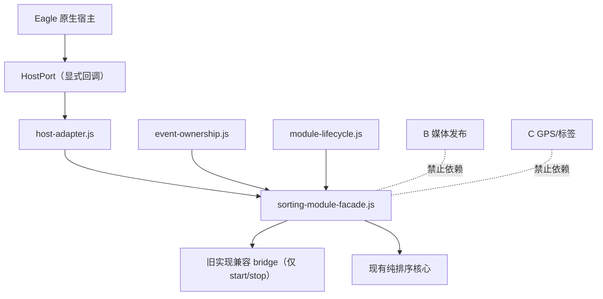

# A 排序模块隔离边界（批次 2）

状态：源码已接入 `plugin.js` 的排序注入入口和改名命令队列；只完成 fake/源码契约，
不安装、不重启 Eagle、不改名、不重排、不操作真实 Library。R34 原生拖出仍是红灯，
R21 自动编号执行链尚未迁移为独立 HostRenamePort；两项都仍需真实 UI 验收。

## 依赖图



facade 是 A 的唯一生命周期组合点。旧注入代码通过
`startSortingModule/stopSortingModule` 注册和释放监听器，外层
`sorting-module-facade` 只通过显式 bridge 驱动它；B/C 没有新的入口。

## 生命周期接口

`module-lifecycle.js` 提供：

- `setEnabled(boolean, reason)`：只改变 A 的开关；关闭会停止 A 并释放资源。
- `start(context)`：未启用时受控跳过；重复启动幂等并返回 `reused`。
- `stop(reason)`：幂等、逆序释放 listener/timer/observer/queue disposer。
- `register(disposer)`：资源必须由 A 自己注册，停止后资源数必须为 0。
- `status()`：返回 `moduleId/state/enabled/resourceCount/lastError`，不暴露 B/C 状态。
- `plugin.js` 的注入侧资源注册通过 `sortingModuleResources` 逆序释放；关闭 A 会移除
  document/window 监听器、菜单定时器和改名预览 observer。

旧 bridge 只能提供可选的 `start()`/`stop()`，不能从 facade 取得 DOM、全局事件或存储。

## Host/Collection adapter 接口

`host-adapter.js` 只依赖显式 `HostPort`：

```text
readCollection(context) -> raw CollectionSnapshot
writeManualView({ ref, revision, relations, legacyFullOrder? }) -> HostResult
requestHostConfirmation(command) -> HostResult
```

adapter 输出统一的 `{ref, revision, members, hostBaseOrder}`：

- `ref.kind` 只有 `normal` 或 `smart`，`targetKind` 只有 `direct-media` 或
  `direct-folders`；父层和叶子层不再通过媒体数组猜测。
- 普通与智能分别由 `createNormalCollectionAdapter`、
  `createSmartCollectionAdapter` 创建，但调用完全相同的 port 和校验。
- `global`、`unknown`、缺少 Library/collection ID、空集合未就绪和成员指纹不一致都返回
  `ControlledUnavailableError`；不得 fallback 到 `raw` 或整库。
- manual overlay 写入必须包含同一 snapshot 和关系涉及的成员 ID；revision 过期直接拒绝。
  旧完整成员数组只作为 `legacyFullOrder` 历史字段保存，不再作为自动排序覆盖。
- adapter 不排序、不生成编号、不访问 DOM、全局对象、localStorage、文件系统或 Eagle API。

## 事件 ownership 表

| 输入 | owner | 可否 `preventDefault` | 说明 |
| --- | --- | --- | --- |
| 模块关闭 | Eagle | 否 | 原生能力完整保留 |
| `dragstart` | Eagle | 否 | 即使来源是网格，也保留文件拖出 |
| Finder/聊天/上传框/其它应用 | Eagle | 否 | `external` 或 source app 不匹配 |
| 跨窗口、离开窗口、取消 | Eagle | 否 | 清理状态并交还宿主 |
| 侧栏、检查器、文件夹树、未知 target | Eagle | 否 | 不取得排序 ownership |
| 网格内、当前 collection、明确有效落点的 `dragover/drop` | A | 是 | 只在此处生成内部 MoveCommand |

`event-ownership.js` 只返回判定；`applyEventOwnership` 只对 `owner=sorting` 且
`canPreventDefault=true` 的事件调用阻止方法。未知情形默认原生放行。

注入侧的 `dragstart` 只观察，不读取/修改 `dataTransfer`，也不阻止默认行为。`dragover`
和 `drop` 先构造 `{windowId, sourceAppId, target.collectionId, target.valid}` 再分类；
只有 `valid-grid-drop` 才调用 `applyEventOwnership`。Finder、聊天框、上传框、侧栏、
未知落点、离开窗口和跨窗口全部不调用阻止方法。

## R21 唯一命令链

```text
有效内部 drop
  -> 最终可见 collection snapshot
  -> RenamePlan
  -> rename-command-queue.enqueue(defer=true)
  -> acknowledgeRenameEnqueue（成功确认后写 signature）
  -> queue.start
  -> claim / process / Eagle 确认
  -> success
```

`rename-command-queue.js` 按 `collectionId` 分队列：同一集合串行，不同集合并行；
失败释放 signature 并恢复原请求，允许重试。刷新、加载、切换、导入、删除和元数据
扫描不调用 `handleRenameBatchRequest` 以外的编号入口。

## 配置与迁移

本批没有迁移配置键。现有 `eagle.photoTakenSort.*` 键仍由旧实现负责；
目标 `eagle.sorting.*` 迁移留到批次 5，采用双读影子比对和显式提交。A facade 不接触
`metaProfiles`、GPS、标签或媒体发布状态。

## 本批文件与回滚

新增：

- `lib/module-lifecycle.js`
- `lib/host-adapter.js`
- `lib/event-ownership.js`
- `lib/sorting-module-facade.js`
- `lib/collection-settings-renderer.js`
- `lib/smart-collection-lifecycle-core.js`
- `lib/smart-collection-presenter.js`
- `test/fixtures/fake-host.js`
- `test/module-boundaries-contract.test.js`

修改：`plugin.js`、`lib/sorting-system-core.js`、`package.json`、现有源码契约测试；
新增 `lib/rename-command-queue.js`、队列测试和 plugin 集成契约测试。回滚只需恢复本批
源码到冻结基线并保留 API 77 安装版/API 75 备份，不触碰用户配置或真实 Library。

智能集合新增模块的所有权固定如下：

- `collection-settings-renderer` 只做普通/智能设置 DOM 的幂等投影；
- `smart-collection-lifecycle-core` 只管理 generation、宿主稳定状态和单 in-flight；
- `smart-collection-presenter` 只封装可取消的网格可见移动，禁止排序规则、持久化、
  自动编号、改名及 Eagle `allData/filtereds` 写入。
- `drag-feedback-controller` 是普通/智能拖动唯一的视觉状态所有者，只接受已解析的
  targetBox/helper/side，负责 start/update/clear；不得生成 MoveCommand、拦截事件、
  捕获指针、创建覆盖层或修改 `dataTransfer`。它必须显式区分宿主投影策略：normal
  可以使用 Eagle helper；smart 禁止遍历或显示全部 helper，也不得改写非当前 helper。
  smart 只允许对 resolver 返回的当前 left/right helper 保存原 inline style 后临时设为
  绝对定位、贯穿目标卡高度的原生 `drag-over`，切换/clear 时精确恢复。只有当前 helper
  确实缺失且 targetBox 已由宿主设为非 static 定位时，才允许投影不参与瀑布流布局的
  完整纵向伪元素，static 时 fail-open；任何路径都不得改写 targetBox 的
  position/overflow。

## 尚未证明

- fake host/源码契约通过不等于真实 UI 通过；R34 仍是红灯，必须在独立测试 Library
  中验证手动开、关、锁定三态拖出和网格内排序。
- `plugin.js` 外层 facade 已通过显式 HostPort 装配，但真实 Eagle CollectionSnapshot
  的完整读写仍由现有注入 context 提供，尚未把所有宿主读写替换为 adapter 调用；这保留
  为下一批的可回滚提取工作，不能宣称 Host adapter 已完成真实宿主验收。
- 树级改名仍通过旧批处理计划进入同一命令队列；旧安全改名实现尚未全部提取为独立
  HostRenamePort，属于后续批次。
