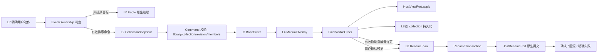

# 排序与重命名目标架构

本文是 A 模块的目标约束，不表示当前代码已经满足。

## L0-L8 层级

| 层 | 所有权 | 可以做 | 禁止做 |
| --- | --- | --- | --- |
| L0 | Eagle 原生主权 | 浏览、选择、原生拖出、预览、导入导出 | 被扩展取消或替代 |
| L1 | 模块生命周期 | A 独立启停、失败隔离、监听清理 | 启动 C、共享业务状态 |
| L2 | Host/collection adapter | 识别普通/智能/父/叶，输出完整集合快照 | 排序、改名、扫描整库 |
| L3 | 纯排序引擎 | 规则规范化、稳定比较、确定性输出 | DOM、Eagle、存储、文件系统 |
| L4 | Manual view overlay | 按 Library + collection 保存稀疏相对位置关系，并叠加到当前自动基础顺序 | 把旧完整数组当成当前自动排序的最高覆盖、跨集合复用 |
| L5 | Protection policy | 对命令返回 allow/deny | 保存顺序、刷新、改名、补执行 |
| L6 | Rename plan/transaction | 预览、最小差异、两阶段提交、回滚 | 隐式触发、直接写 `.library` |
| L7 | UI 与事件 ownership | 把明确用户动作翻译为 command | 私自排序、抢占未知原生事件 |
| L8 | 持久化、迁移、诊断 | schema、原子写、审计、恢复 | 混用配置键、猜测恢复 |

低层必须服从高层。L7 不能绕过 L2-L6，L8 不能用旧状态改变当前业务语义。

## 唯一业务数据流



这条链中没有第二个排序器、第二个拖动状态机或第二个改名执行器。

## 核心模型

```text
CollectionRef = { libraryId, collectionId, kind, targetKind }
CollectionSnapshot = { ref, revision, members[], hostBaseOrder[] }
SortRuleSet = { schemaVersion, rules[] }
BaseOrder = itemId[]
ManualView = {
  ref,
  schemaVersion: 3,
  relations: [{ itemId, relation: "before"|"after", anchorId }],
  legacyFullOrder?: itemId[],
  revision
}
FinalVisibleOrder = { ref, memberFingerprint, itemIds[], source }
ProtectionState = { ref, locked, revision }
RenamePlan = { commandId, ref, sourceOrderFingerprint, entries[] }
RenameTransaction = { commandId, phase, entries, results, rollback }
```

所有对象必须可序列化、可追踪。任何命令缺少 Library ID、collection ID 或成员指纹
时拒绝执行。

## 唯一事实源

| 事实 | 唯一来源 |
| --- | --- |
| 当前集合成员 | L2 adapter 明确返回的 `CollectionSnapshot.members` |
| 自动基础顺序 | L3 纯排序输出或 adapter 的原生基础顺序 |
| 手动后顺序 | L4 当前 Library + collection 的 `ManualView` |
| 最终可见顺序 | base order 叠加 manual overlay 后的 `FinalVisibleOrder` |
| 是否允许动作 | L5 guard，只返回 allow/deny |
| 编号输入 | 本次 `FinalVisibleOrder`，不得重读 raw/DOM/时间数组 |
| 改名结果 | L6 transaction 经 HostRenamePort 确认的结果 |
| UI 显示 | 上述状态的只读投影，不是新的业务事实 |

DOM 只能帮助 adapter 读取/确认当前屏幕，不得成为可跨刷新持久化的第二套顺序。

## collection adapter

统一接口：

```js
readCollection(context) -> CollectionSnapshot | ControlledUnavailable
applyVisibleOrder(snapshot, finalOrder) -> ApplyResult
observeHostEvent(event) -> HostEvent
```

- 普通叶子：仅直属素材，`targetKind=direct-media`。
- 普通父层：仅直属子文件夹，`targetKind=direct-folders`。
- 智能集合：只消费当前结果，保留来源集合引用，不回退 `raw` 整库。
- “全部”、未分类和未知上下文：返回 `ControlledUnavailable`，不扫描整库。
- adapter 不得调用排序、保护、编号或持久化。

智能集合的宿主生命周期必须显式经过
`idle -> loading -> stabilizing -> ready/empty/error`。每次切换生成新的
generation/token；旧 token 的结果一律丢弃。加载中的临时 0 只表示宿主尚未稳定，
不得清空当前原生画面。smart presenter 只按 ID 调用单点可见适配器，不得写
`allData/filtereds`；适配失败时放行 Eagle 原生结果。

## 手动顺序

1. 有效网格内 drop 产生 `MoveCommand`。
2. L4 把本次移动编码为相对关系，例如 `B after C`，不保存整表覆盖。
3. 每次切换自动规则先重算 `BaseOrder`，再稳定应用相对关系。
4. 关闭手动输入只拒绝新 `MoveCommand`；不清除活动关系。
5. “恢复自动排序”清除活动关系并立即刷新；旧 v2 完整数组只保留为
   `legacyFullOrder` 迁移/回滚记录。
6. 新成员按当前自动规则稳定补入，删除锚点的关系受控失效，不猜测位置。

## 保护

Protection 是纯 guard：

```js
guard(command, protectionState) -> { allowed, reason }
```

开关保护只写 `ProtectionState`。它不得调用排序、刷新、DOM 捕获、改名计划或恢复
旧快照。配置传播仍可到保护层，真正改变顺序/文件名的命令被拒绝。

## 编号与安全改名

只有两类显式动作可创建计划，且仅适用于普通集合：

1. 用户完成有效网格内拖动，且该 collection 已允许“拖动后自动编号”。
2. 用户查看逐项预览后确认执行。

智能集合只负责当前查询结果的自动排序和手动相对位置，不显示自动编号入口，
不构造 `RenamePlan`，也不进入 `RenameTransaction`；其来源普通文件夹的文件名和编号状态
保持不变。

开关、启动、刷新、切换、分页、滚动、列表补全、拍摄时间回填、成员监听和迁移都
没有创建计划的权限。

唯一执行器接收不可变 `RenamePlan`：

```text
validate collection + membership + names
-> temporary-name phase
-> verify
-> final-name phase
-> verify
-> commit result
or rollback -> explicit failure/recovery state
```

执行只通过 `HostRenamePort`，禁止 `item.save()` 冒充文件改名，禁止直接写
`.library`。渲染进程不得存在另一条 `ayncsImagesChange` 入口。

## 事件 ownership

| 事件/动作 | owner | 是否可拦截 | 结果 |
| --- | --- | --- | --- |
| `dragstart` | Eagle | 否 | 保留原生文件拖出 |
| 网格外拖放 | Eagle | 否 | Finder/聊天/上传等原生目标 |
| 有效网格卡片 `dragover/drop` | A/L7 | 仅命中有效落点后 | `MoveCommand` |
| 单击、右键、快捷键、预览 | Eagle | 否 | 原生语义 |
| 规则/开关 UI | A/L7 | 仅插件控件自身 | 配置 command |
| Library 切换 | L1/L2 | 否 | 取消旧上下文并读取新 snapshot |

所有 listener 必须由 L1 注册并返回 disposer。停止 A 后 listener、observer、timer、
queue 必须为 0。

## 持久化目标

目标分别存储：

- `eagle.sorting.rules.v1`
- `eagle.sorting.manualInput.v1`
- `eagle.sorting.manualViews.v1`
- `eagle.sorting.protection.v1`
- `eagle.sorting.autoNumber.v1`
- `eagle.sorting.renameTransactions.v1`

旧 `eagle.photoTakenSort.*` 只由迁移器读取。迁移采用双读、影子比对、显式提交、保留
旧键的方式；不得启动时自动删除旧状态。

## 失败隔离

- A 失败不得打开 C 窗口或停止 C/B。
- 单 collection 改名失败只失败该 command，并释放队列。
- NAS 暂不可用返回明确不可操作，不重试成高频轮询。
- adapter 失去宿主结构时关闭 A 的写能力，Eagle 原生继续可用。
- UI、日志和诊断都必须显示 Library、collection、command ID 和第一失败原因。
