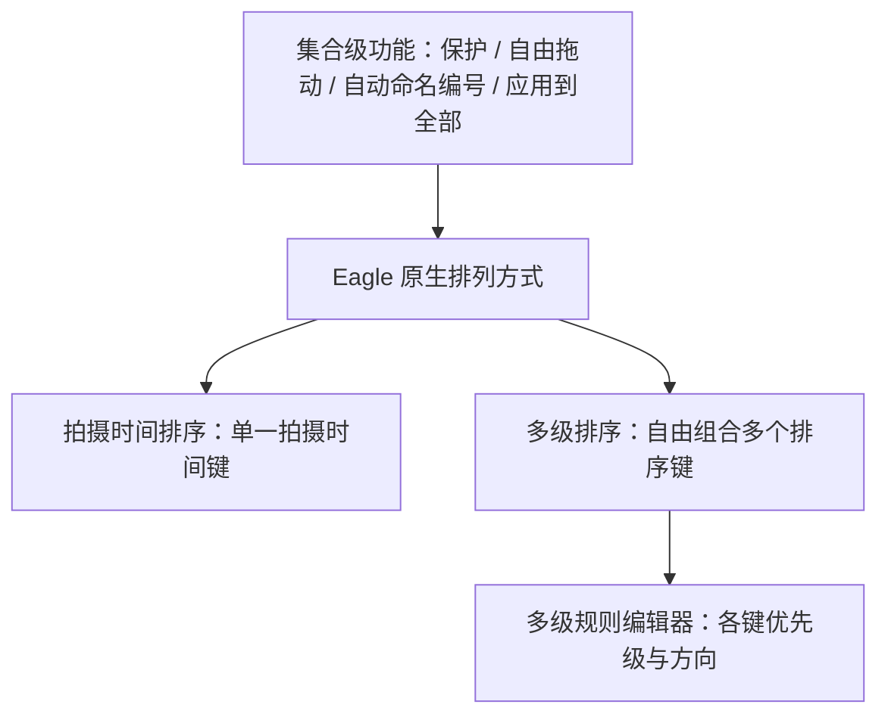
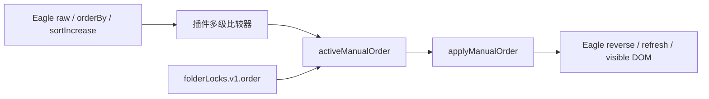
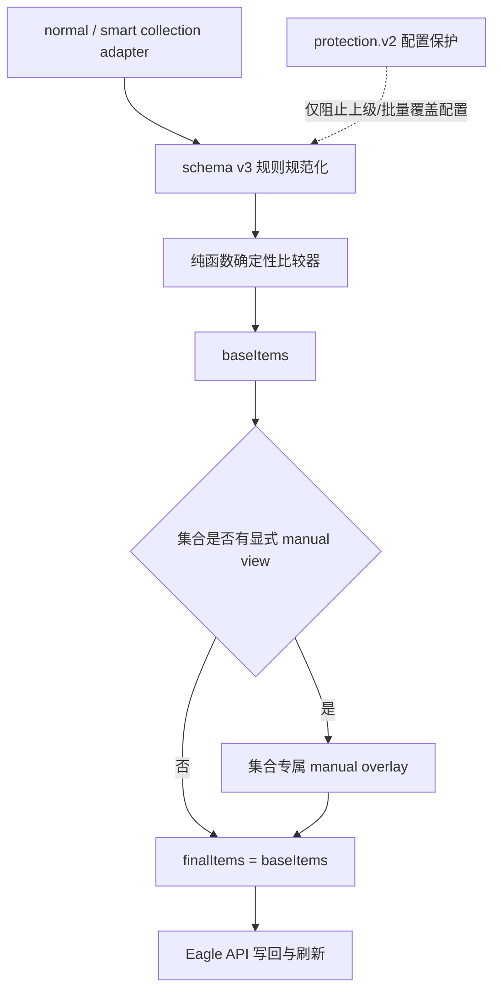

# 排序引擎 2.5.0

## 范围与安全边界

本轮重构只修改插件源码、自动测试、文档和候选包。没有恢复或覆盖已安装插件，
没有重启 Eagle，也没有写入或手工修改任何 `.library` 内部文件。

## 产品层级与排列方式

界面和运行时都按固定优先级拆分：

`拍摄时间排序`不是`多级排序`的别名，也不是多级规则的预设；它们是两个并列的
`orderBy`。旧 `PHOTO_TAKEN` 持续作为兼容的多级排序键，新单一拍摄时间排序使用
`PHOTO_TAKEN_AT`。集合级功能在 DOM 中插入 Eagle 原生 `sortPanel` 之前，规则编辑器
位于原生排列方式之后；切换原生或拍摄时间排序时集合级功能仍然可见。

## 旧架构与根因

旧实现把“防止全局覆盖”的项目 ID 快照当成手动顺序：

`activeManualOrder()` 在保护开启时读取 `folderLocks.v1.order`，使确定性比较器的
结果被旧可见顺序再次覆盖。自动编号、刷新或重新捕获视图又可能更新该快照，错误
顺序因此跨刷新保留。艺术展 `MKPBIEGNPKQR9` 的 48 项现场证据为：比较器结果本身
无分组断裂，但可见尾部出现 `2-艺术展36`、`2-艺术展37`、`1-艺术展9`、
`1-艺术展10`、`1-艺术展11`，综合可见违规为 7。

## 目标模型

四层职责严格分开：

1. 集合适配：普通文件夹、智能文件夹和全局视图转换成统一 collection。
2. 确定性排序：纯逻辑产生 `baseItems`，不访问 UI 或 Eagle API。
3. 手动视图：只有明确拖动后才对当前集合应用 `manualViews.v2`。
4. 配置保护：`protection.v2` 只保护 `orderBy`、`sortIncrease` 和多级规则。

## schema v3 比较规则

- 文件名先做 NFKC，统一全半角、破折号、空格和扩展名，再做数字感知自然排序。
- 旧 `NAME_GROUP` 迁成 `NAME` 的 `{ groupPrefix: true, prefixOnly: true }`
  解析选项；它只比较 `1-`/`2-` 前缀，组内交给下一排序键。
- 普通 `NAME` 仍比较完整文件名，正确处理 9/10、中英文、空格、全半角和同名扩展名。
- `拍摄时间排序`只使用拍摄时间一个键；`多级排序`的每个键各自保存升降序，
  不再由 Eagle 的外层升降序批量反转规则。
- 拍摄时间降级链为缓存 `takenAt/timestamp`，项目 `takenAt`，再到
  `DateTimeOriginal`、`DateCreated`、`CreateDate`、`ModifyDate`。
- 缺失时间无论升降序都固定在有效时间之后。
- 规则相同后依次使用完整自然文件名、扩展名、项目 ID 和源索引稳定兜底。

## 普通与智能集合

| 行为 | 普通文件夹 | 智能文件夹 |
| --- | --- | --- |
| 比较器 | schema v3 共用引擎 | schema v3 共用引擎 |
| 规则 | `rules.v2.folders` | `rules.v2.smartFolders` |
| 配置保护 | `protection.v2.folders` | `protection.v2.smartFolders` |
| 手动视图 | 当前普通文件夹专属 | 当前智能查询视图专属 |
| 应用到全部 | 当前文件夹及全部子文件夹 | 仅当前智能文件夹 |
| 自动改名 | 普通文件夹预览后执行 | 必须先预览并列出受影响来源文件夹 |

智能文件夹的手动视图不会写入来源普通文件夹的手动顺序。实现不直接操作
`.library`，只通过 Eagle 已有对象与 API 工作。

## 迁移与回滚

- 启动时读取 `folderLocks.v1`，把 17 个旧保护条目迁成 `protection.v2` 的
  `protected: true + config`。
- 旧 `order` 数组共 809 个项目 ID，只写入
  `legacyOrderDiagnostic: { ignored: true, itemCount }`，绝不写入
  `manualViews.v2`。
- `manualViews.v2` 初始为空；只有明确拖动才创建集合专属记录。
- 旧 key 保留为只读迁移输入，便于回退到 2.4.8；2.5.0 不删除旧状态。
- 回滚插件时，先退出 Eagle，备份整个已安装插件目录和当前团队 sidecar，再恢复
  2.4.8 插件目录。2.4.8 不认识新 key，会继续读取旧 key；不得把
  `legacyOrderDiagnostic` 反写成 `order`。

## 自动验收

- 艺术展真实 48 项 ID、名称和拍摄时间已固化在 `test/sort-core.test.js`。
- 旧截图尾部顺序可见违规：7。
- schema v3 raw/base、无 manual 的 visible、刷新后、自动编号模拟后：均为 0。
- 覆盖自然文件名、时间缺失、重名、独立方向、稳定兜底和显式手动覆盖。
- 覆盖普通/智能共用模型、混合来源、手动视图隔离、来源影响预览。
- 覆盖 17 个保护状态和 809 个旧项目 ID 的安全迁移及 JSON 重载持久化。

真实 Eagle UI 和真实 Library 验收必须等待用户明确批准安装候选包后执行。

## 候选包与安装前备份点

- 候选包：`releases/媒体智能整理-v2.5.0.eagleplugin`
- SHA-256：`fd56b42afa4dcaefe338b72f19cf3b59d1b9aadeb1b67687b47250a05c17484e`
- 当前只读核对的已安装版：2.4.8，目录为
  `/Users/max/Library/Application Support/Eagle/Plugins/com.max.eagle-photo-taken-sort`
- 安装前必须先退出 Eagle，并把上述整个目录备份到带时间戳的
  `/Users/max/Library/Application Support/Eagle/Backups/media-organizer-plugin-before-2.5.0-*`。
- 同时备份当前 Library 同级的 `.eagle-team-state.json`；若不存在则记录“不存在”，
  不创建空 sidecar。

已知限制：候选包尚未做真实 Eagle UI、Eagle 反向排序写回、智能文件夹查询结果和
真实 Library 重开持久化验收；旧 sidecar 首次仍需通过 legacy key 迁移，新
`protection.v2/manualViews.v2` 只有在 2.5.0 明确发布团队状态后才进入新 sidecar。
