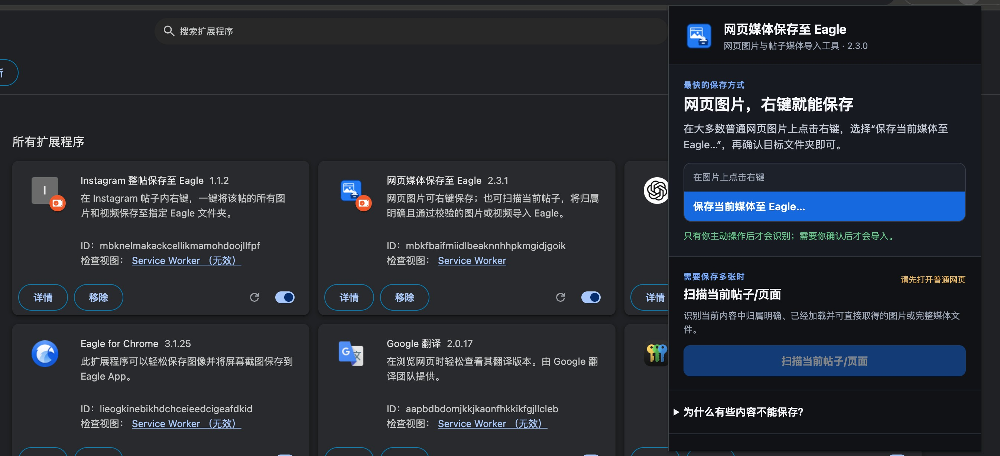
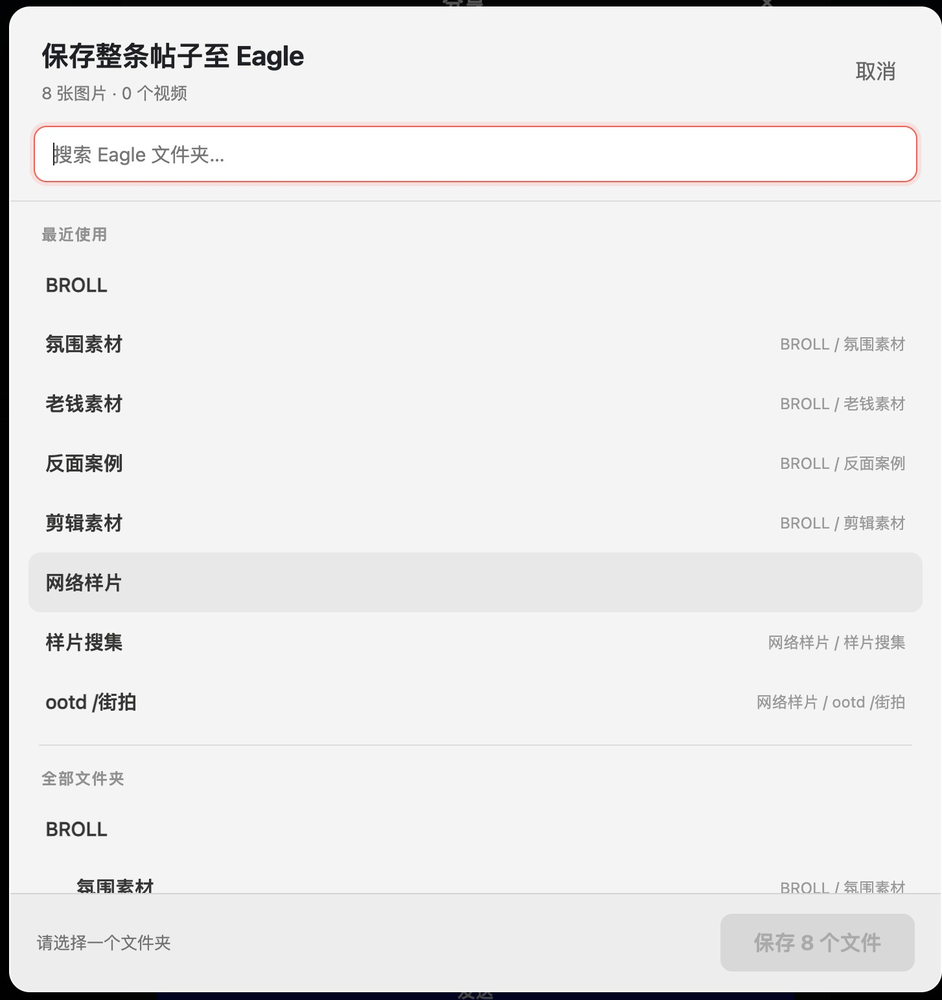
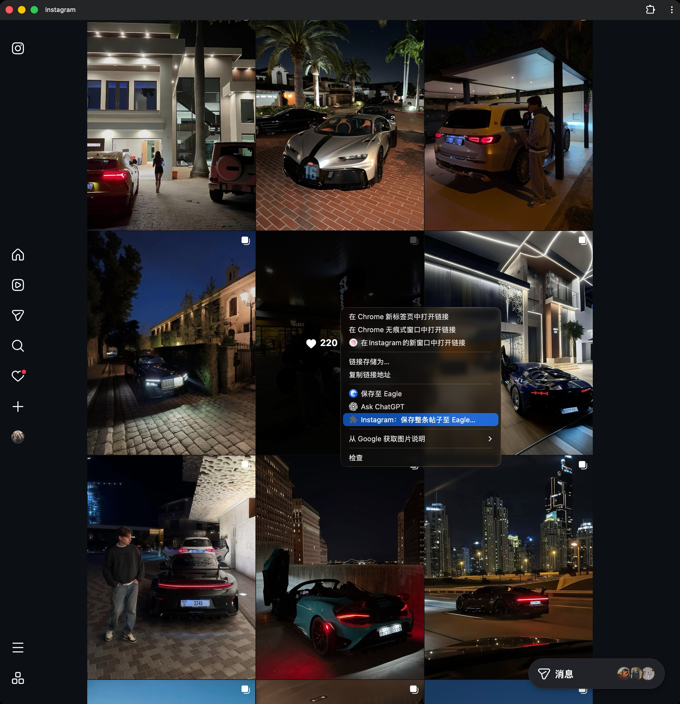

# 网页媒体保存至 Eagle：2026-08-16 对抗性体验与可靠性审查

## 证据与范围

本报告只使用本次用户提供并已保存、检查的截图，以及当前源码与测试。没有安装、重启 Chrome/Eagle，也没有读取或写入真实 Eagle Library、NAS 或账号页面；因此不能把本报告写成真实下载或 Eagle 可见验收。

## 体验流程审查

1. **扩展说明与入口 — 健康度：需改进。**
   截图显示当前弹窗把“右键单张”和“扫描当前帖子/页面”并列，但没有告诉用户 Instagram 应走哪个动作，也没有把“能否保存”的失败原因带到触发处。截图中的界面版本还是 `2.3.0`，而源码曾是 `2.3.1`，这是一个可见的版本同步风险：已加载扩展可能没有被重新加载。

2. **Instagram 整帖入口 — 健康度：缺失后已补齐。**
   历史专用扩展在帖内右键有“保存整条帖子”，并在选择器里呈现 `8 张图片 · 0 个视频`。通用扩展之前没有 Instagram provider，只会把 Instagram 当作通用网页：在网格、推荐流和多帖页中归属不足时只能拒绝或表现不稳定，无法承诺一条帖的全部轮播媒体。2.4.0 增加了明确的 Instagram 整帖入口与单帖所有权门禁。

3. **文件夹选择与确认 — 健康度：可用但摩擦高，已改进。**
   历史截图的“最近使用 + 全部文件夹 + 选中状态 + 保存数量”路径明显更快。通用扩展后台本来已经取得 `listRecent`，但内容脚本没有展示，导致每次都从完整树搜索。2.4.0 恢复最近使用分区，同时保留普通文件夹限制、项目数确认和安全警告。

## 第一性原理结论

保存“看得见的图片”不是单一步骤，而是五个必须分别成立的事实：

1. 用户到底授权了单张、当前帖，还是整页？
2. 该媒体能否证明属于用户选中的内容，而不是头像、推荐或相邻帖子？
3. 能否获得公开、完整、非流式的 HTTP(S) 文件？
4. Chrome 最终下载的文件是否仍是安全且类型正确的媒体？
5. Eagle 是否不仅接收请求，而且能读回到用户选定的普通文件夹？

当前架构在第 3–5 层已经较强：下载 MIME/大小/最终来源验证、持久队列、未知交接停止重试，以及 Eagle `accepted` 与 `confirmed` 分离都在代码中。真正影响“保存不上去”和“用起来不顺”的主要薄弱处是第 1–2 层：网页 DOM 变化、站点特定所有权和 UI 对失败原因的表达。

## 发现与修复状态

| 优先级 | 发现 | 影响 | 处理 |
| --- | --- | --- | --- |
| P1 | Instagram 被当作通用页面，缺少单帖/轮播所有权模型 | 整帖保存缺失；多帖场景体验不稳定 | 已在 2.4.0 新增 Instagram provider、整帖入口与轮播恢复逻辑 |
| P1 | 通用扫描只接受唯一 `article/main`，这是安全正确但没有充分解释 | 用户会感到“明明看到图片却不能保存” | 已在确认框直接显示可导入、阻止与未加载数量；仍建议实机补全失败原因文案 |
| P1 | 当前版本未进行真实 Chrome→下载→Eagle 读回验收 | 不能证明防盗链、登录态、CDN 和 Eagle UI 当前可用 | 保持未验收状态；需要用户明确许可后分层测试 |
| P2 | 后台已有“最近使用”文件夹数据，旧选择器没有展示 | 重复搜索路径，批量保存不顺 | 已恢复最近使用区 |
| P2 | 旧确认框的连续长句混合了数量、安全限制与视频政策 | 关键信息难扫读 | 已精简为可导入数、阻止/遗漏和有条件警告 |
| P2 | 扩展卡片/弹窗可见版本与源码版本存在不同步迹象 | 用户难以判断修复是否真的生效 | 2.4.0 已统一 manifest、package 与弹窗版本；安装后仍需人工重新加载 |
| P3 | 轮播总数通常依赖页面可访问性文字 | Instagram DOM 改版时可能只能收集已访问项 | 明确提示遗漏数；不猜测、不补造候选 |

## 可用范围（诚实表述）

- **可靠单张：** 用户右键选择的公开 HTTPS 图片。它仍会经下载后验证，不能保证每个站点的防盗链都接受。
- **可靠批量：** 页面能唯一证明当前内容、媒体已经在当前 DOM 或 Instagram 当前轮播中可访问、且下载完成后可验真的图片/完整直连视频。
- **明确不支持：** `blob:`/`data:`、HLS/DASH、DRM、分轨或无音轨证明视频、需要绕过登录/反爬/权限的资源、没有唯一内容归属的多帖页面。
- **Instagram：** 用户在当前帖媒体上触发时，收集该帖可访问轮播项并恢复原位置；每项仍是独立 Eagle 素材，但全部导入同一个用户选定文件夹，并共享同一来源帖 URL 与 `来源:instagram` 标签。

## 可见的无障碍风险与限制

确认框现在有 `role="dialog"`、`aria-modal`、可搜索输入和 Escape 关闭；截图无法证明完整键盘焦点循环、屏幕阅读器播报或高对比度，因此这些仍需在真实 Chrome 中测试。截图也不能证明下载状态、网络失败或 Eagle API 读回状态是否在实际设备可感知。

## 本次实现验证

- 59/59 自动测试通过。
- 所有运行脚本通过 JavaScript 语法检查。
- `git diff --check` 通过。
- 未执行真实 Chrome、Instagram 或 Eagle 写入。
